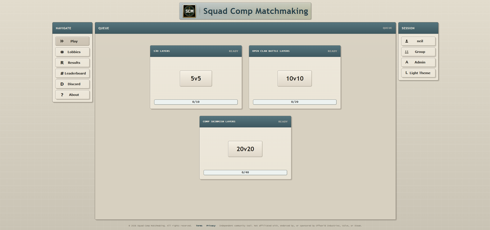
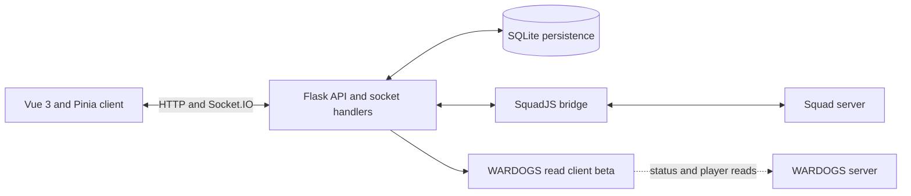
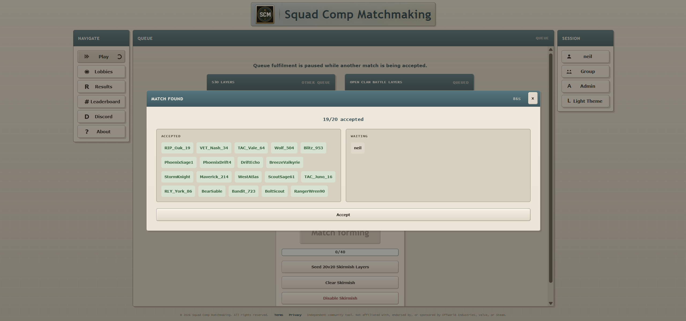
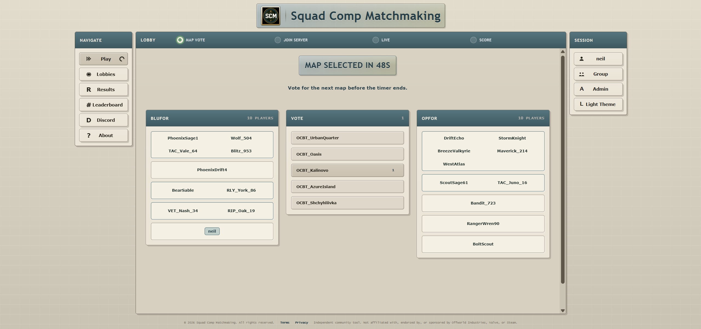

# Competitive Matchmaking Platform

Competitive Matchmaking Platform (CMP) is a Flask/Vue web app for organising competitive Squad matches. Players sign in with Steam, join queues, accept a match, vote through lobby phases and receive server details. Socket.IO keeps the queue and lobby views in sync. It began as a university honours project and was later used for organised community matches.

The Squad flow is implemented; the hosted instance is now offline. The repository also contains a WARDOGS beta queue and backend-connected lobby under development. CMP can allocate a configured WARDOGS server, show read-only observations and support manually confirmed results, but automated WARDOGS match lifecycle and result detection are unverified. See the [WARDOGS capability matrix](docs/wardogs/CAPABILITIES.md) and [roadmap](docs/wardogs/ROADMAP.md).

## Demo

**[Watch the matchmaking and lobby demo](https://www.youtube.com/watch?v=KlR_l0pL4qo)**

The former VPS deployment is offline. Run the project locally using the instructions below to explore the interface.



The screenshots are genuine local development captures of the Squad interface. The queue shown above is empty; the match images below use populated local test data.

## How it fits together



The backend owns matchmaking and lobby state, persists recoverable state in SQLite, and sends updates to connected clients. The SquadJS bridge handles Squad server integration. The WARDOGS read client observes server state; it does not establish an automated match result.

### Match flow





## Implemented Squad features

The game-server items below describe the Squad flow. WARDOGS beta capabilities and limits are documented separately.

- Steam OpenID authentication with local password auth kept as a development/test fallback.
- Real-time queue, group, lobby and match-acceptance flows using Socket.IO.
- Multiple queue modes with configurable team sizes and map pools.
- Lobby phases for match acceptance, map voting, team assignment, server joining, live play and score/history.
- SquadJS bridge integration for server presence, live-roll checks, RCON automation and server status.
- Admin tools for queue management, lobby recovery, server diagnostics and automation mode control.
- SQLite-backed persistence for users, queue state, lobbies, server registry, audit events and completed match history.
- Elo rating updates for completed matches.
- Docker Compose deployment with Caddy reverse proxy, health checks, log rotation, backup and restore scripts.
- Backend and frontend tests covering queue, lobby, auth, persistence, history, Elo, socket services and UI store behaviour.

## Stack

- Python, Flask, Flask-SocketIO and Eventlet
- SQLite
- Vue 3, Pinia, Vue Router and Vite
- Socket.IO
- Docker Compose, Caddy and Nginx
- Jest and Vue Test Utils
- Pytest
- Git

## Repository Structure

```text
backend/
  app.py, app_core.py       Flask app wiring and core orchestration
  services/                 Auth, queue, bridge, history, Elo, persistence and server services
  sockets/                  Socket.IO event handlers
  state/                    Runtime queue, lobby and group state helpers
  tests/                    Unit and integration tests

frontend/
  src/views/                Main Vue pages
  src/features/             Feature components and composables
  src/stores/               Pinia stores for auth, queue, lobby, group and sockets
  tests/                    Jest unit tests

squadjs/
  cmp/                      CMP bridge helpers
  squad-server/plugins/     SquadJS plugin integration

scripts/                    Local development, smoke test, backup and restore helpers
deploy/                     Caddy configuration
docs/                       Deployment and integration notes
```

## Requirements

For local development:

- Python 3.12 or newer
- Node.js 20.17 or newer for frontend development
- npm

For full stack / server integration:

- Node.js 22 or newer for the bundled SquadJS workspace
- Docker Desktop
- A Squad server and SquadJS setup
- Steam Web API credentials for production display-name lookup

## Local Development

On Windows, choose a target from the repository root:

```powershell
npm run dev:squad      # Squad UI; starts SquadJS by default
npm run dev:wardogs    # WARDOGS beta UI; no SquadJS
npm run dev:local      # General local mode
```

To inspect the Squad UI without SquadJS or a game server, run:

```powershell
$env:CMP_START_SQUADJS = "0"
npm run dev:squad
```

The launcher uses Python 3.12, Flask and Vite. Install backend and frontend dependencies first. The local UI is available at `http://127.0.0.1:5173`; unset the override with `Remove-Item Env:CMP_START_SQUADJS -ErrorAction SilentlyContinue` when finished. Match completion and live server actions require a configured integration.

Manual setup is also possible.

Backend:

```powershell
cd backend
python -m venv venv
.\venv\Scripts\python.exe -m pip install -r requirements.txt -r requirements-test.txt
Copy-Item .env.example .env
.\venv\Scripts\python.exe app.py
```

Frontend:

```powershell
cd frontend
npm install
Copy-Item .env.example .env
npm run dev
```

The frontend dev server proxies API requests to the backend. Keep real secrets in local `.env` files only.

For local WARDOGS testing, `npm run dev:local` starts the CMP backend and Vite frontend at
`http://127.0.0.1:5173`; WARDOGS has no extra process. SquadJS is not started by
default. Set `CMP_START_SQUADJS=1` before running the command if you also need
Squad integration. The script enables backend `CMP_DEV_MODE=1`, local password
auth, and the WARDOGS poller's five-second default. Production remains at 20
seconds. `WARDOGS_POLL_INTERVAL_SECONDS` can override either default (2–3600
seconds). The Vite frontend proxies `/api` and `/socket.io` to port 5000.

To test a WARDOGS match with one person:

1. Install backend requirements for Python 3.12 and frontend npm dependencies;
   from the repository root run `npm run dev:local`.
2. Open `http://127.0.0.1:5173/auth` and sign in with a local test account or
   Steam. Link your real Steam ID in Profile. The account must have admin access
   for the developer tools (`ADMIN_STEAM_IDS` for a Steam account).
3. Open `http://127.0.0.1:5173/play`, choose **WARDOGS Beta 9**, and join as
   the real account. Open `/admin` and click **Fill WARDOGS beta queue**.
4. Eight deterministic `__dev_wardogs_…` accounts fill the remaining slots.
   Normal matchmaking opens acceptance; only those test accounts auto-accept.
   Accept the match yourself in the normal Play UI. The finalized lobby contains
   three factions of three; use **Open my WARDOGS lobby** on the admin page.
5. If a configured, enabled WARDOGS server is available, allocation runs
   automatically. Otherwise use **Retry WARDOGS allocation** on `/admin`.
   The lobby shows the verified Join By ID when the backend
   can read `/v1/server-id`; enter it in WARDOGS under Deploy → Community →
   Join By ID. Join the server with your real Steam account.
6. CMP polls read-only `/v1/status` and `/v1/players`. On `/admin`, click
   **Simulate test players connected** to project the synthetic accounts as
   aligned in the UI. They are explicitly marked DEV simulated; your own real
   WDRCON observation, server scores, and observation freshness remain real.
7. Click **View as participant**, then revisit the lobby to inspect its
   participant controls. The switch only affects this browser session's
   WARDOGS UI; your persisted admin role is unchanged. Return to `/admin` and
   click **View as admin** to restore result controls.
8. At any point, confirm a manual test result on the lobby page. A completed
   win or tie produces rating changes shown in the lobby; no natural match end
   or WDRCON write is required. For another test, use **Reset queued test
   players / overlay**, then **Delete test lobby / release server** on `/admin`.
   Completed result/rating history is retained.

The developer endpoints are JWT/admin protected and return 404 unless the
backend has `CMP_DEV_MODE=1`. Keep local test data in a separate SQLite database.
For real allocation, register an enabled WARDOGS server with its backend-only
`wdrcon_secret_env` referencing a `CMP_WARDOGS_RCON_…` environment variable;
the credential and WDRCON URL must never be placed in frontend variables.

## Docker

Copy the example environment files and replace placeholders with your own local or server values:

```powershell
Copy-Item .env.example .env
Copy-Item backend\.env.example backend\.env
Copy-Item frontend\.env.example frontend\.env
```

Then start the stack:

```powershell
docker compose up -d --build
```

See [SELF_HOSTING.md](SELF_HOSTING.md) and [PRODUCTION_DEPLOYMENT.md](PRODUCTION_DEPLOYMENT.md) for fuller runbooks.

## Testing

Backend:

```powershell
cd backend
.\venv\Scripts\python.exe -m pytest
```

Frontend:

```powershell
cd frontend
npm test -- --runInBand
```

Production build:

```powershell
cd frontend
npm run build
```

## Security Notes

- Real `.env` files, databases, logs, backups and generated dependency folders are intentionally ignored.
- Production startup rejects weak secrets, insecure public origins and unsafe password-auth settings.
- Admin-only queue and lobby mutation paths are guarded server-side and covered by tests.

## Portfolio Notes

This project is larger than the small Laravel and PWA projects on my profile. It is useful for discussing real-time systems, state recovery, test coverage, deployment trade-offs, external integrations and how I break a larger app into services, socket handlers and frontend stores.
